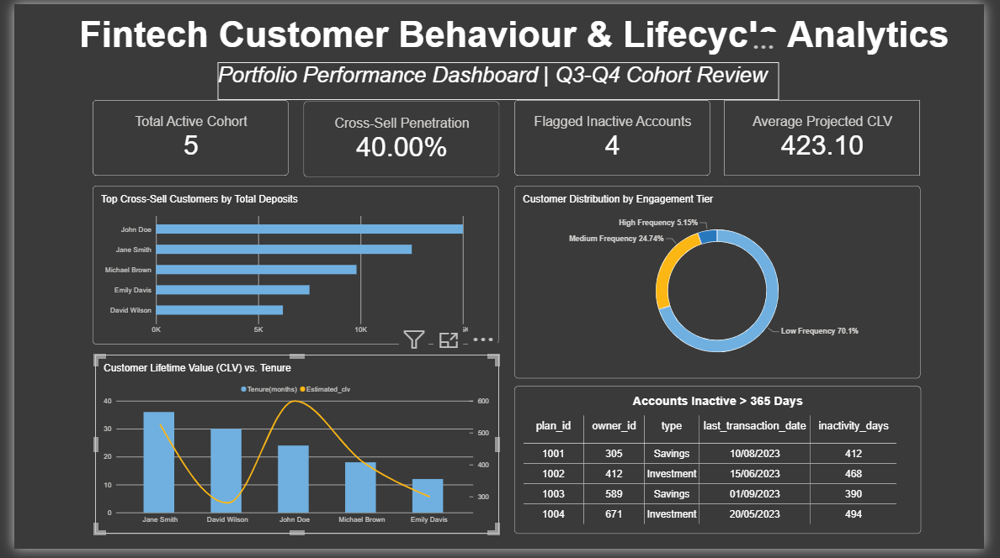

# Fintech Customer Behavior & Lifecycle Analytics

## Project Overview

This project explores customer behavior and business performance within a fintech ecosystem using SQL and Power BI.

Originally developed as part of a Data Analyst SQL proficiency challenge, the project addresses four key business questions relating to customer value, product adoption, transaction engagement, and account inactivity.

Using relational customer, savings, investment, and transaction data, I developed SQL queries to transform raw records into structured analytical outputs and built an interactive Power BI dashboard to communicate the results.

The objective is to demonstrate how SQL-based analysis can support business decisions around customer retention, cross-selling, engagement, and marketing strategy.

> **Data Privacy:** The sample CSV outputs provided in the `results/` directory contain synthetic illustrative data. They demonstrate the expected analytical output structure and should not be interpreted as actual customer-level findings.

---

## Business Objectives

The analysis addresses four business problems:

| Business Question | Business Objective |
|---|---|
| High-Value Customers with Multiple Products | Identify cross-selling opportunities among customers holding savings and investment products. |
| Transaction Frequency Analysis | Segment customers according to their average monthly transaction activity. |
| Account Inactivity Alert | Identify savings and investment accounts with no recent inflows for over 365 days. |
| Customer Lifetime Value Estimation | Estimate customer value using account tenure and transaction activity. |

---

## Dataset & Schema

The project uses four relational tables from a fintech database.

| Table | Description |
|---|---|
| `users_customuser` | Customer demographic and contact information. |
| `plans_plan` | Savings and investment plans created by customers. |
| `savings_savingsaccount` | Deposit and inflow transaction records. |
| `withdrawals_withdrawal` | Customer withdrawal transaction records. |

### Key Relationships

- `owner_id` links customer records to their savings and transaction records through `users_customuser.id`.
- `plan_id` links savings transactions to their corresponding records in `plans_plan.id`.

### Important Data Fields

| Field | Description |
|---|---|
| `is_regular_savings` | Identifies regular savings plans (value = 1). |
| `is_a_fund` | Identifies investment plans (value = 1). |
| `confirmed_amount` | Confirmed deposit/inflow amount. |
| `amount_withdrawn` | Withdrawal amount. |
| `transaction_date` | Date of the transaction. |
| `date_joined` | Customer registration date. |

**Currency convention:** Monetary amounts are stored in Kobo. Values are divided by 100 when converted to Naira for financial reporting.

---

## SQL Analysis & Methodology

### 1. High-Value Customers with Multiple Products

**Business Problem**

The business wants to identify customers who hold both savings and investment products to uncover cross-selling opportunities and recognize high-value customer segments.

**Approach**

- Used conditional aggregation to count savings and investment plans per customer.
- Aggregated confirmed deposits by customer.
- Joined the aggregated results with customer demographic information.
- Filtered customers holding at least one savings plan and one investment plan.
- Ranked qualifying customers by total deposit value.

**Business Application**

The resulting customer segment can help marketing teams identify existing customers who demonstrate interest in multiple financial products and may be suitable for targeted product campaigns.

### 2. Transaction Frequency Analysis

**Business Problem**

The finance team wants to understand customer engagement by measuring how frequently customers transact.

**Approach**

- Aggregated transaction records by customer and calendar month.
- Calculated each customer's average monthly transaction frequency.
- Applied conditional `CASE WHEN` logic to assign engagement categories.
- Aggregated the resulting customer distribution by frequency tier.

**Segmentation Criteria**

| Category | Average Monthly Transactions |
|---|---|
| High Frequency | 10 or more |
| Medium Frequency | 3–9 |
| Low Frequency | 2 or fewer |

**Business Application**

The segmentation provides a basis for identifying highly engaged customers, monitoring occasional users, and developing retention campaigns for customers with lower transaction activity.

### 3. Account Inactivity Alert

**Business Problem**

The operations team wants to identify active savings and investment accounts that have experienced no inflow transactions for more than 365 days.

**Approach**

- Used a Common Table Expression (CTE) to standardize savings and investment account classifications.
- Established a reference date using the latest transaction date available in the dataset.
- Used a `LEFT JOIN` to retain accounts without matching transaction records.
- Applied conditional date calculations to determine inactivity from either the last transaction date or account start date.
- Filtered accounts exceeding the 365-day inactivity threshold.

**Business Application**

The resulting records can support operational monitoring, customer re-engagement campaigns, and retention efforts.

### 4. Customer Lifetime Value (CLV) Estimation

**Business Problem**

Marketing wants to estimate customer value based on account tenure and transaction activity to support customer acquisition and retention decisions.

**Approach**

- Joined customer records with deposit transaction data.
- Calculated customer tenure in months using `TIMESTAMPDIFF`.
- Aggregated transaction activity and transaction value by customer.
- Converted transaction values from Kobo to Naira.
- Applied the simplified CLV estimation formula.
- Used `NULLIF` to prevent division-by-zero errors for customers with zero months of tenure.

**Estimation Formula**

CLV = (Average Monthly Transaction Value × 12) × 0.001

Where:

- Average Monthly Transaction Value = Total Transaction Value / Tenure in Months.
- 12 represents annualization.
- 0.001 represents the assumed profit margin of 0.1%.

**Business Application**

The estimated value provides a simplified basis for comparing customer segments and supporting marketing resource allocation.

> **Model Limitation:** This is an annualized transaction-value-based profit estimate, not a comprehensive predictive lifetime value model. It does not account for acquisition costs, customer churn, future purchasing behavior, or discount rates.

---

## Power BI Executive Dashboard

An interactive Power BI dashboard was developed to translate the SQL analytical outputs into a visual business intelligence report.



### Dashboard Components

**1. Executive KPI Overview**

Provides a high-level summary of customer activity, cross-sell adoption, account inactivity exposure, and estimated customer value.

**2. Top Cross-Sell Customers**

Ranks customers holding multiple financial products by their total deposit value.

**3. Transaction Frequency Distribution**

Visualizes customer distribution across High, Medium, and Low Frequency engagement categories.

**4. Customer Lifetime Value vs. Tenure**

Explores the relationship between customer account longevity and estimated customer value.

**5. Account Inactivity Monitoring**

Displays savings and investment accounts flagged for more than 365 days of inactivity.

### DAX Measures

A dedicated `_Measures` table was created to organize explicit DAX calculations, including:

- Total Active Cohort
- Cross-Sell Penetration
- Flagged Inactive Accounts
- Average Projected CLV

The measures support consistent KPI calculations and reduce reliance on implicit visual aggregations.

---

## Technical Skills & SQL Concepts Demonstrated

**SQL**
- Common Table Expressions (CTEs)
- Subqueries and conditional aggregation
- INNER JOIN, LEFT JOIN and CROSS JOIN
- GROUP BY and HAVING
- CASE WHEN conditional logic
- Aggregate functions: SUM, COUNT, AVG and MAX
- Date calculations using DATEDIFF and TIMESTAMPDIFF
- NULL handling with COALESCE and NULLIF
- Currency conversion and numeric formatting

**Power BI**
- Data visualization and dashboard development
- Explicit DAX measures
- KPI design
- Customer segmentation and comparative analysis
- Executive-level reporting

---

## Key Deliverables

- Four SQL queries addressing distinct fintech business problems.
- Structured analytical outputs for customer segmentation, product adoption, account inactivity and customer value.
- An interactive Power BI executive dashboard.
- A collection of documented SQL methodologies and business interpretations.

---

## Project Structure

```text
fintech-customer-behavior-sql-analysis/
│
├── README.md
│
├── 01_high_value_cross_sell_customers.sql
├── 02_transaction_frequency_segmentation.sql
├── 03_dormant_account_inactivity_audit.sql
└── 04_customer_lifetime_value_estimation.sql
│
├── results/
│   ├── 01_high_value_cross_sell_customers.csv
│   ├── 02_transaction_frequency.csv
│   ├── 03_account_inactivity_alert.csv
│   └── 04_customer_lifetime_value.csv
│
└── assets/
    └── dashboard_overview.png
```

---

## Final Takeaways

This project demonstrates the application of SQL and Power BI to practical fintech business problems.

It showcases the process of translating business requirements into analytical queries, working with relational customer and transaction data, developing customer segmentation logic, estimating customer value, and communicating insights through interactive visualizations.

The analysis provides a foundation for data-driven decision-making across customer engagement, cross-selling, retention, and marketing strategy.

